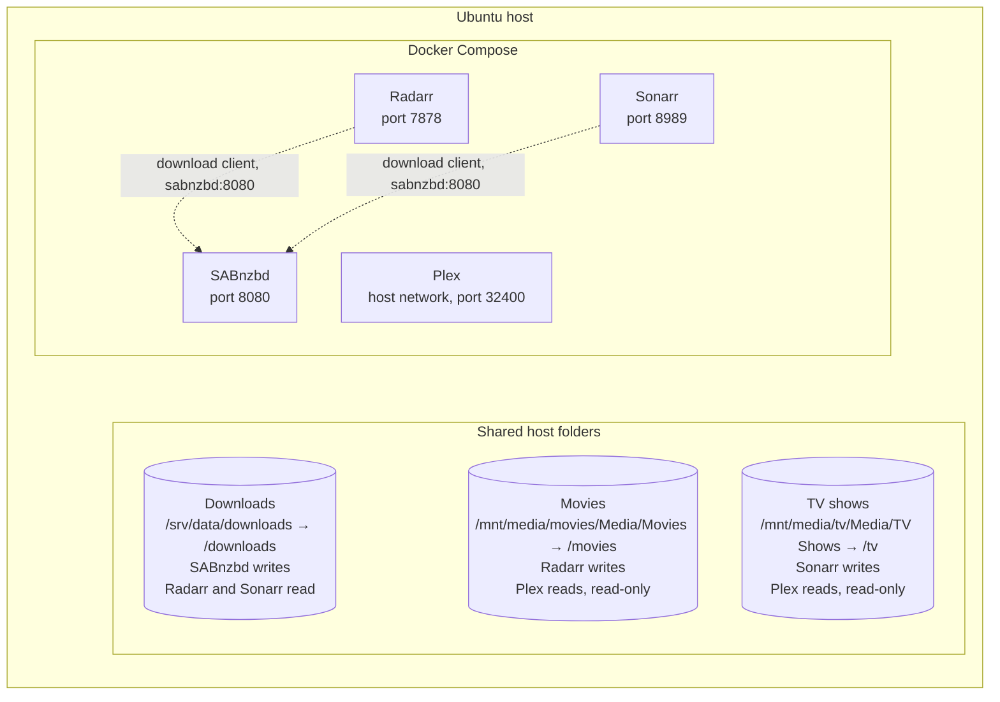

# Ubuntu Plex Media Server — Docker Compose Setup Guide

Build your own **self-hosted media server on Ubuntu** with **Plex, Radarr, Sonarr, and SABnzbd**. This repository includes a real-world Docker Compose configuration and practical setup instructions for beginners.

> **Before you begin:** This is a documented working configuration, **not** a one-click installer. You must adapt storage paths, permissions, and application settings to your server. Portainer is installed separately on the original server and is not included in this Compose file.

## Architecture

Docker Compose runs Plex, Radarr, Sonarr, and SABnzbd on the Ubuntu host. Movies, TV, and downloads are shared host folders. Radarr and Sonarr send download jobs to SABnzbd on the Compose network. Plex uses the host network and reads the libraries after they are imported.



Plex mounts `/movies` and `/tv` read-only. Radarr writes `/movies`, Sonarr writes `/tv`, and Radarr, Sonarr, and SABnzbd all mount `/srv/data/downloads` at `/downloads`. Each container also keeps its own config directory (`./plex`, `./radarr`, `./sonarr`, `./sabnzbd`).

## What each application does

| Application | Role | Local web address |
| --- | --- | --- |
| **Plex** | Organizes and streams your personal media library | `http://SERVER_IP:32400/web` |
| **Radarr** | Organizes your movie library | `http://SERVER_IP:7878` |
| **Sonarr** | Organizes your TV library | `http://SERVER_IP:8989` |
| **SABnzbd** | Download client for a provider you configure | `http://SERVER_IP:8080` |

Replace `SERVER_IP` with the LAN IP of **your** Ubuntu server. Keep management interfaces private; do not forward these ports directly to the internet.

## Prerequisites — what you need before starting

### Hardware and software

- **Ubuntu server:** A spare PC, mini PC, or server running a supported Ubuntu release, with an administrator account that can use `sudo`.
- **Storage:** Enough free space for your movies, TV shows, application settings, and downloads. You should know where your drives or network shares are mounted.
- **Network:** A reliable home network connection and your server's local IP address. Internet access is needed to download container images and complete initial setup.
- **Docker Engine and Docker Compose:** You will install these in Step 1 using the [official Docker Ubuntu guide](https://docs.docker.com/engine/install/ubuntu/).
- **Git (recommended):** Helpful for cloning this repository; alternatively, download the Compose file manually.

### Accounts, services, and initial setup

To get the **complete media-management workflow** working, you'll need to set up all four applications plus a compatible download source. The applications run on your own server; they do **not** all require separate accounts on their official websites.

| Application or service | What you need before the system is fully functional |
| --- | --- |
| **[Plex](https://www.plex.tv/)** | Create a Plex account to sign in and claim/configure your Plex server. A free account is sufficient to get started; certain features may require a paid plan. |
| **[Radarr](https://radarr.video/)** | Install and configure the Radarr container, movie root folder, download client, and any compatible indexers. **No Radarr website account is required.** |
| **[Sonarr](https://sonarr.tv/)** | Install and configure the Sonarr container, TV root folder, download client, and any compatible indexers. **No Sonarr website account is required.** |
| **[SABnzbd](https://sabnzbd.org/)** | Install and configure the SABnzbd container and connect it to your Usenet provider. **No SABnzbd website account is required.** |
| **Usenet provider** | **An account with a Usenet provider** is required if you want SABnzbd to download from Usenet. Have its server address, port, username/password, and SSL settings ready. This may require a paid subscription. |
| **Indexers** | Set up compatible indexers for Radarr and Sonarr. Depending on the indexer, registration, an API key, or a subscription may be required. |
| **[Portainer](https://www.portainer.io/)** | Optional graphical Docker management. The original server uses Portainer separately; this repository does not deploy it. |

**Important:** Docker Compose installs and starts the Plex, Radarr, Sonarr, and SABnzbd **containers**, but you must still open their web interfaces and complete each application's setup. You do not need to register a separate online account with Radarr, Sonarr, or SABnzbd.

**Before proceeding:** Create your Plex account, identify your storage folders, and have your Usenet provider credentials and any indexer details ready if you plan to use those services. Never commit passwords or API keys to GitHub.

The example uses `PUID=1000`, `PGID=1000`, and `TZ=America/Chicago`. Verify your own values before deploying.

## Step 1 — Prepare Ubuntu

Update your server:

```bash
sudo apt update
sudo apt upgrade -y
```

Install **Docker Engine** and the **Docker Compose plugin** by following the [official Docker installation guide for Ubuntu](https://docs.docker.com/engine/install/ubuntu/). It covers supported Ubuntu releases and the correct package repository.

Verify the installation:

```bash
sudo docker --version
sudo docker compose version
```

Commands below use `sudo docker` so they work without adding your account to the Docker group. **Docker access is effectively root-level access**, so grant it only to trusted users.

## Step 2 — Prepare your storage

The original server uses these **host paths**:

| Purpose | Original server path |
| --- | --- |
| Movies | `/mnt/media/movies/Media/Movies` |
| TV shows | `/mnt/media/tv/Media/TV Shows` |
| Downloads | `/srv/data/downloads` |

**You do not need to use those exact paths.** For a simple fresh-server example, you could create:

```bash
sudo mkdir -p /srv/media/movies /srv/media/tv /srv/data/downloads
```

Make sure your storage is mounted and writable by the account your containers use. Check its user and group IDs with:

```bash
id
ls -ld /srv/media/movies /srv/media/tv /srv/data/downloads
```

Do not blindly change ownership of an existing library or network share. See [Storage and permissions](docs/storage-and-permissions.md) for more detail.

## Step 3 — Get the configuration

Create a dedicated directory:

```bash
sudo mkdir -p /opt/media-server
```

Download the repository's [compose.yaml](compose.yaml) and place it at `/opt/media-server/compose.yaml`, or clone the repository and copy that file into your project directory.

For example, with Git installed:

```bash
git clone https://github.com/edragon12/ubuntu-plex-media-server.git
sudo cp ubuntu-plex-media-server/compose.yaml /opt/media-server/compose.yaml
```

Open the file for editing:

```bash
sudo nano /opt/media-server/compose.yaml
```

**Change the host-side paths** in the `volumes` entries to your actual folders. If you used the example directories in Step 2:

- Replace `/mnt/media/movies/Media/Movies` with `/srv/media/movies`.
- Replace `/mnt/media/tv/Media/TV Shows` with `/srv/media/tv`.
- Leave `/srv/data/downloads` unchanged.

Keep the **container-side paths** (`/movies`, `/tv`, and `/downloads`) as they are. Those are the paths the applications will use internally.

Check `id` and update `PUID`/`PGID` if your user IDs differ. Adjust `TZ` to your time zone.

**Important:** The supplied Plex configuration has read-only media mounts and `restart: "no"`. Plex will not automatically restart after a reboot. Radarr, Sonarr, and SABnzbd use `restart: unless-stopped`. These settings reflect the original server; review them for your own needs.

## Step 4 — Validate and start the containers

```bash
cd /opt/media-server
sudo docker compose config
sudo docker compose pull
sudo docker compose up -d
sudo docker compose ps
```

The `config` command should complete without errors. If a media mount is missing, verify its path before starting. Plex explicitly requires its host media folders to exist.

The first download may take several minutes depending on your connection.

## Step 5 — Open the web interfaces

Find your Ubuntu server's local IP address:

```bash
hostname -I
```

Then, from a browser on the same trusted network, open the URLs in the table above.

If a page does not load, check `sudo docker compose ps`, container logs, and your host firewall rules. Plex uses host networking in this example; the other three services publish ports `7878`, `8989`, and `8080`.

## Step 6 — Connect the applications

1. Complete SABnzbd's first-run setup with your own provider and download configuration.
2. In **Radarr**, use `/movies` as the root folder. Add SABnzbd as a download client, using host `sabnzbd`, port `8080`, and the SABnzbd API key.
3. In **Sonarr**, use `/tv` as the root folder and connect SABnzbd similarly.
4. In **Plex**, add a Movies library pointing to `/movies` and a TV library pointing to `/tv`.

Configure download categories and library scanning to suit your setup. See the [application connections guide](docs/application-connections.md) for more details.

## Step 7 — Verify everything works

Check container status:

```bash
cd /opt/media-server
sudo docker compose ps
```

View recent logs:

```bash
sudo docker compose logs --tail=100
```

Confirm that Plex sees your libraries, Radarr/Sonarr can access their media folders, and the download client writes to the shared `/downloads` path. Do not assume file imports or hardlinks will work across separate storage filesystems without testing.

## Everyday maintenance

```bash
cd /opt/media-server

# Check status
sudo docker compose ps

# View recent logs
sudo docker compose logs --tail=100

# Stop services (preserves application config directories)
sudo docker compose down

# Start services
sudo docker compose up -d
```

To update images, **back up your application settings first**, review upstream release notes, then run:

```bash
sudo docker compose pull
sudo docker compose up -d
```

The Compose file uses mutable `latest` tags. Pin tested versions if you want reproducible deployments.

## Further guides

- [Storage and permissions](docs/storage-and-permissions.md)
- [Application connections](docs/application-connections.md)
- [Operations and troubleshooting](docs/operations-and-troubleshooting.md)
- [Security and publishing](docs/security-and-publishing.md)

## Security and limitations

This public repository intentionally excludes personal media, application configuration databases, API keys, credentials, SSH keys, and download-provider settings. The `.gitignore` excludes local application data. **Do not commit those files.**

The example does not configure hardware transcoding, external storage mounts, a firewall, remote access, VPN, indexers, or Portainer. Those require separate setup and verification.

Use software and content in accordance with applicable laws and service terms.

## License

MIT — see [LICENSE](LICENSE).
